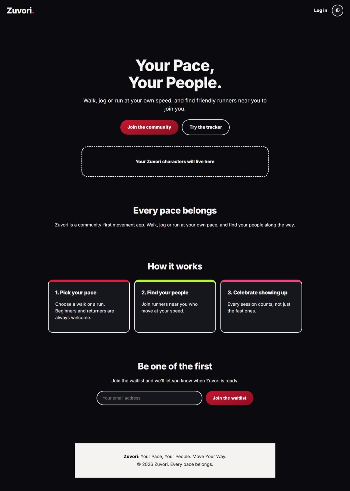
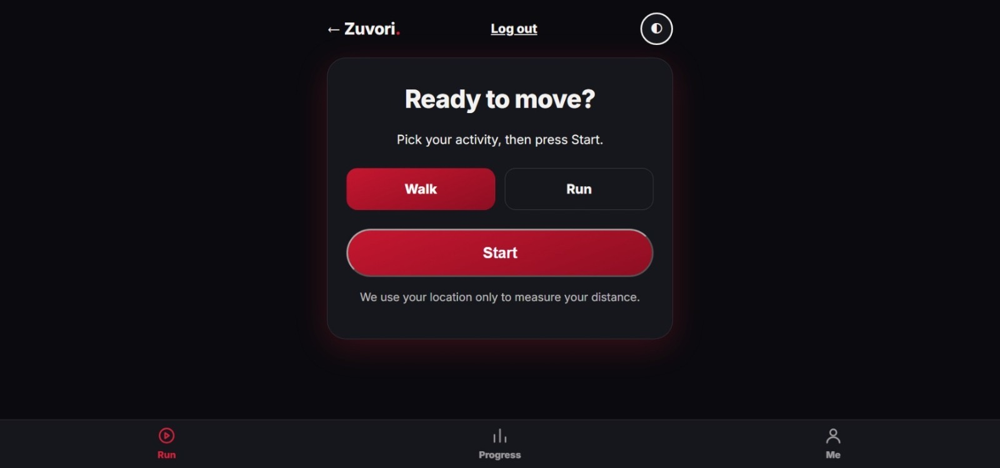
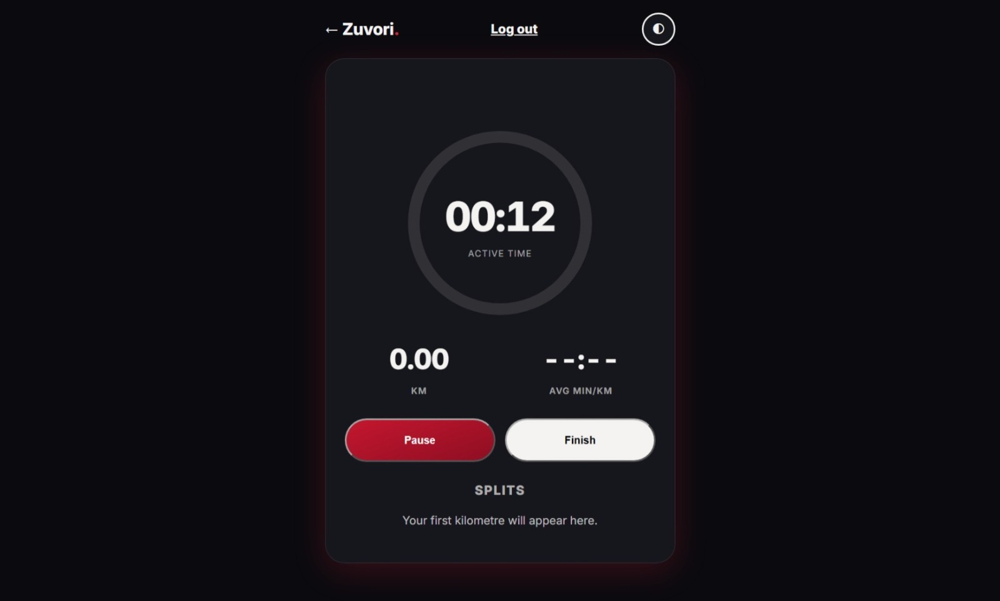
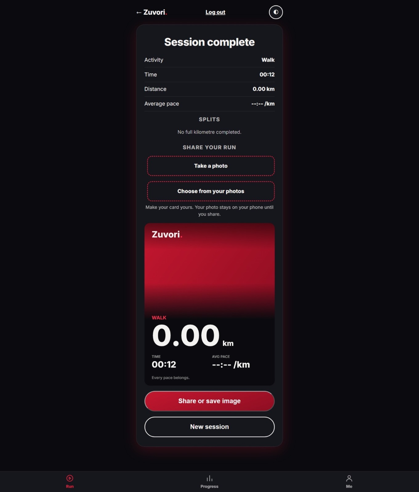
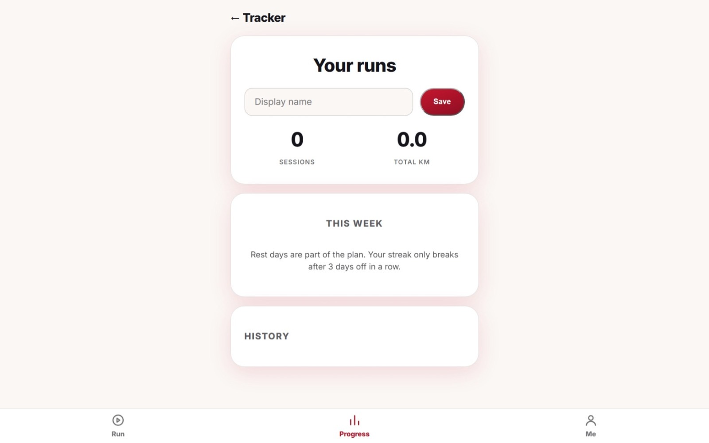
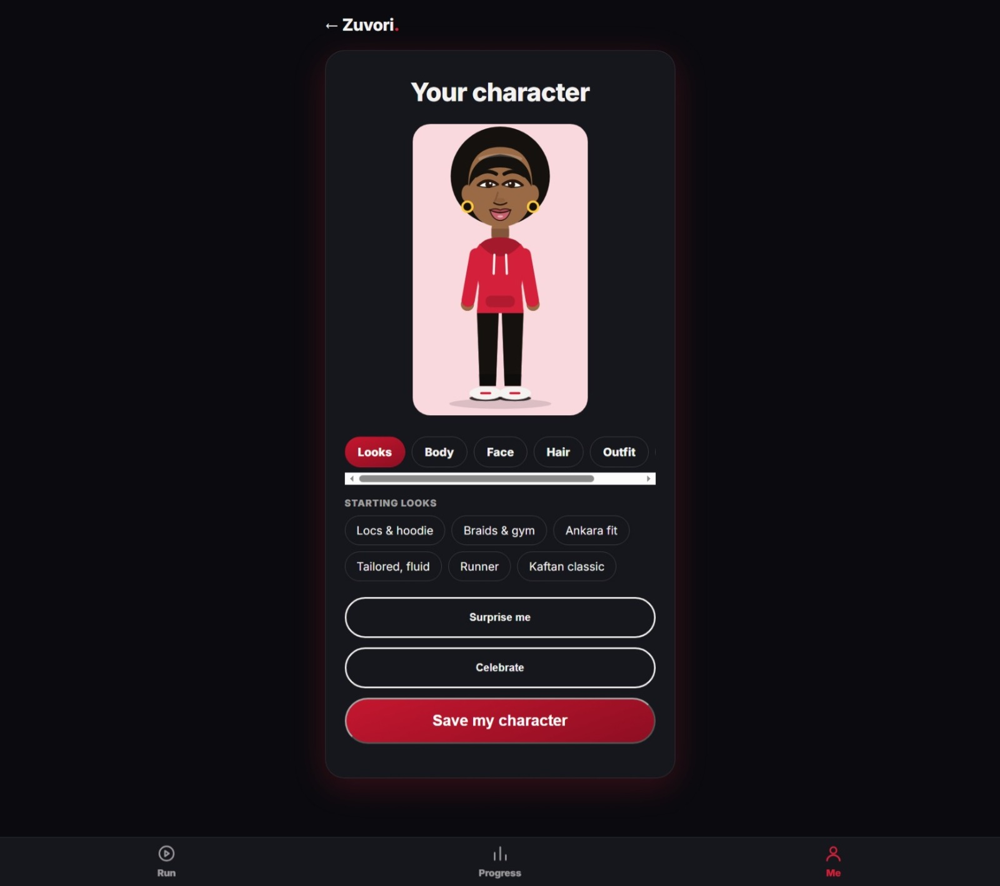

# Zuvori — Your Pace, Your People.

A community-first movement and fitness platform designed to bring people together through walking, jogging and running.

Zuvori is built around a simple belief: every pace belongs.

## About the Project

Zuvori is an evolving movement platform that combines activity tracking, personalisation and community-focused experiences.

The goal is to make everyday movement more engaging, accessible and enjoyable.

## Features Currently Implemented

- GPS-powered activity tracking
- Distance calculation
- Activity and pace tracking
- Run history
- Activity streaks
- Customisable characters and outfits
- Multiple movement options: walking, jogging and running

## Features in Development

- Nearby runner discovery
- Additional community and social features
- Further platform improvements

## Tech Stack

- HTML5
- CSS3
- JavaScript (Vanilla)
- Supabase

## Live Application

[Explore Zuvori](https://round-river-ff9f.ehihebolova.workers.dev/)

[Try the Activity Tracker](https://round-river-ff9f.ehihebolova.workers.dev/app/)

## Project Status

Zuvori is an ongoing independent project. Core activity-tracking and character-personalisation features are implemented, while community discovery and additional features are still being developed.

## Vision

To build a movement community where people can stay active, connect with others and move at their own pace.

**Your Pace, Your People.**

## Screenshots

### 1. Landing Page

### 2. Activity Selection

### 3. Active Session Tracker

### 4. Session Complete and Sharing

### 5. Progress and Run History

### 6. Character Customisation

